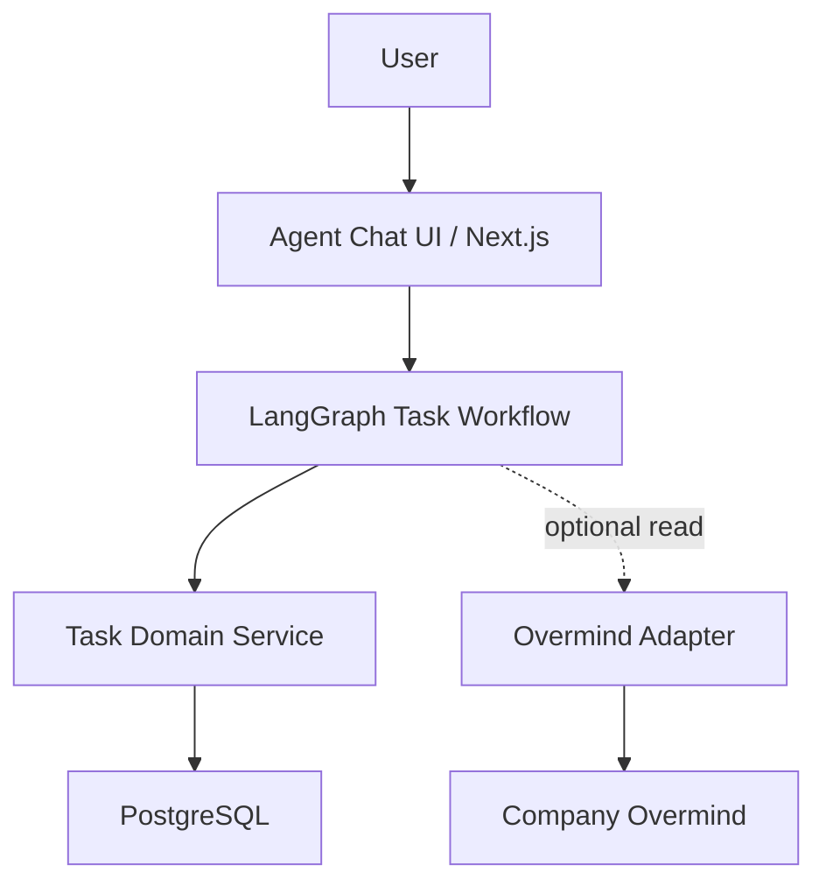

# Architecture

## Initial deployment



MVP에서 FastAPI는 Task CRUD와 인증된 실행/조회 엔드포인트를 제공한다. Agent Chat UI는 LangGraph Agent Server가 기대하는 message/state 계약에 맞춘다. FastAPI와 LangGraph server의 라우팅 또는 프록시 구성은 통합 테스트에서 결정하고 문서화한다.

## Modules
```text
personal-agent-os/
├── backend/
│   ├── app/web/           # 보드와 채팅 단일 페이지
│   ├── app/api/           # FastAPI, health/task/web routes
│   ├── app/agents/task/   # LangGraph nodes, state, prompts
│   ├── app/domain/tasks/  # Entity, validation, transition service
│   ├── app/persistence/   # SQLAlchemy, Alembic, repositories
│   ├── app/llm/           # LLM provider 인터페이스, Claude Agent SDK 구현
│   ├── app/trackers/      # 2325, Slack, Claude Code 수집기, 정리
│   └── tests/
├── infra/                 # postgres compose, systemd, 2325 터널, 백업, Windows 스크립트
└── docs/
```

## Responsibility boundaries
| Component | Owns | Does not own |
|---|---|---|
| LangGraph | intent extraction, routing, clarification, context selection | canonical Task persistence |
| Task Domain Service | CRUD invariants, status transitions, idempotency, audit trail | prompting and model calls |
| PostgreSQL | tasks, field evidence, task events, relationships, checkpoints | company-wide knowledge |
| Overmind Adapter | authorized read of company context | personal Task source of truth |
| 웹 페이지 (app/web) | 보드, 채팅, 완료와 제안 거절 | direct DB writes |
| Temporal (future) | long-lived external workflows and retry orchestration | agent reasoning |

## Workflow design
- `parse_intent` → `extract_fields` → `resolve_task` → conditional `enrich_context` → `validate`
- If information is critical and ambiguous → `clarify` via `interrupt()`, then resume and revalidate.
- Otherwise → `persist_and_respond` for mutations, or `read_and_respond` for queries.
- Graph checkpoint and Task DB are different: checkpoint thread IDs are not Task IDs.
- Treat LLM output as untrusted structured suggestions; validate in domain code before writes.

## Security
- Read-only integration by default; separate capability permissions for write actions.
- No company credentials or raw data committed; local secrets via environment or secret manager.
- Personal Task access requires authentication before public/cloud deployment.
- Track source references and timestamp on externally derived facts.
- Never grant coding agent unrestricted production shell/DB access.
