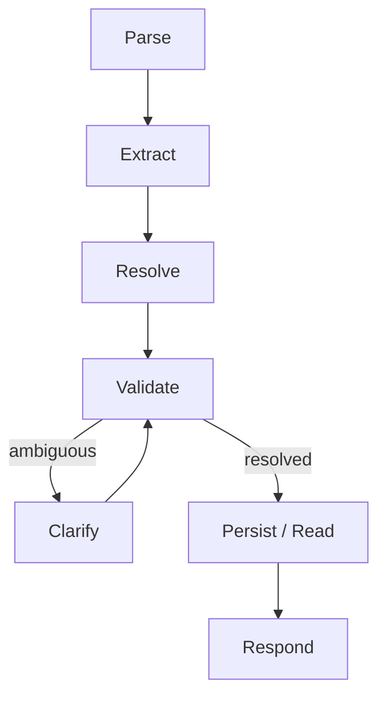

# Natural Language Task Agent

## Product behavior — B mode
AI extracts project, priority, description and suggested steps. Ask follow-up questions only if a required value or target identity is materially ambiguous. A missing due date is valid; do not invent one.

## Example commands
| Input | Operation | Clarification |
|---|---|---|
| 내일까지 2325 Eval 돌려야 해 | create | no, due_date = tomorrow in Asia/Seoul |
| 이번 주 할 일 알려줘 | read | no |
| 2325 Eval 완료했어 | complete | if multiple matching tasks |
| 그거 금요일까지 미뤄줘 | update | if prior referent unresolved |
| 나중에 B 고객사 건도 해야 해 | create | no, due_date = null |
| 이 작업 배포해 | execution request | must not deploy; request approval via separate workflow |

## Graph nodes
1. `parse_intent`: create/read/update/complete/cancel.
2. `extract_fields`: structured Pydantic output, explicit/inferred/default provenance.
3. `resolve_task`: search existing tasks for references, duplicates or edits; return candidates.
4. `enrich_context`: only when project context is needed; optional Overmind read-only Tool.
5. `validate`: deterministic rule checks; reject nonexistent target, contradictory dates.
6. `clarify`: interrupt and ask one precise question; merge response then revalidate.
7. `persist_and_respond` or `read_and_respond`: transactionally apply command or answer.



## Extraction schema (conceptual)
```python
class TaskDraft(BaseModel):
    title: str | None = None
    description: str | None = None
    project: str | None = None
    priority: Literal["low", "medium", "high", "urgent"] | None = None
    due_date: date | None = None
    due_time: time | None = None
    subtasks: list[str] = Field(default_factory=list)

class TaskIntent(BaseModel):
    action: Literal["create", "read", "update", "complete", "cancel"]
    target: str | None = None
    draft: TaskDraft | None = None
```
Per-field metadata must separately record origin and evidence; simply marking entire draft as inferred is insufficient.

## Clarification and inference policy
- Default status = todo; priority = medium if no signal.
- If user says “내일” and no time, store `due_date` only; `due_at` null.
- If date is relative, resolve using `Asia/Seoul`, request timestamp and timezone.
- If update/complete refers to multiple plausible Tasks, **do not guess**.
- Suggested subtasks are proposals unless user requests actual decomposition.
- No silent deadline changes, destructive deletes, Slack sends, deployments.
- Keep explicit and inferred values distinct; offer corrections in natural language.

## Correctness and evaluation
- Same `request_id` never produces duplicate Task.
- Retried LangGraph node cannot duplicate event or side effect.
- Ambiguous referent asks instead of modifying wrong task.
- Thread can resume after process restart.
- Model extraction errors do not corrupt persisted Task.
- Track intent accuracy, clarification rate, mistaken-target rate and task save success.
